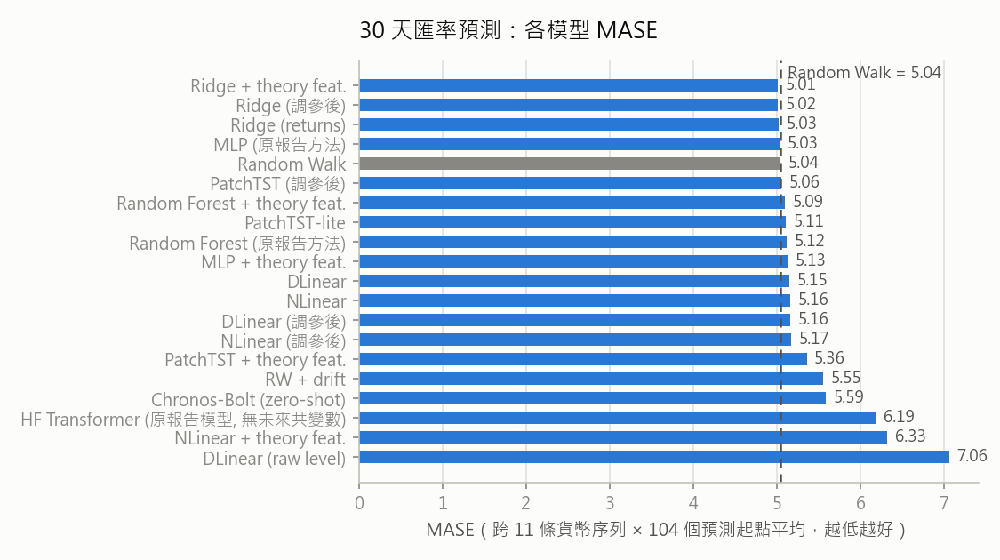
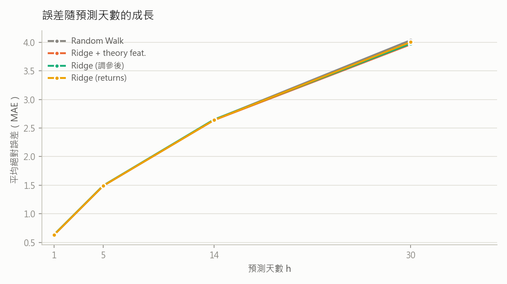

# 匯率預測實驗改善結果（v2）

## 評估方法（與原 NSTC 報告的差異）

- **Rolling-origin 回測**：原報告只用單一一個 30 天測試視窗；本實驗改用 2 個年度測試區間（2023-03-03 ~ 2024-02-23、2022-03-04 ~ 2023-02-24），每區間 52 個預測起點（每 5 個交易日一個）× 11 條貨幣序列，每個區間各自重訓，並以 Diebold-Mariano 檢定（HAC 變異數 + HLN 小樣本修正）判斷是否顯著優於 Random Walk。
- **歐元區去重**：原資料 17 國中有 7 國（austria/belgium/finland/france/germany/italy/spain）1999 年後是同一條歐元序列（日報酬率完全相同，僅差固定舊幣換算比率），已合併為單一 eurozone 序列，避免評估被歐元重複加權 7 倍。
- **修正資料洩漏**：原程式把預測視窗內的未來遠期匯率與未來利率餵給模型（HF TimeSeriesTransformer 的 `feat_dynamic_real` 會進 `future_time_features`）；本實驗所有模型（包含重測的 HF Transformer）不再使用預測視窗內的未來共變數。**注意：本結果產生時理論特徵未延後（feat_lag=0）**。AUD/CAD/DKK/JPY/NOK/CHF/GBP 的遠期匯率取價晚於即期定盤，`fwd_premium` 含次日即期報酬資訊，所有使用理論特徵的模型結果都不可採信，包括帶 `_feat` 的模型、選中 use_feats=True 的 tuned_ridge、Ridge + 理論特徵的敏感度網格，以及 rw_challenge 的 ridge 系列（見 docs/extension_report.md §0）。目前 `load_panel` 預設 feat_lag=1，重跑實驗即可得到修正後的結果。
- **訓練流程**：early stopping（驗證集與測試區間隔 30 天 embargo）、神經模型多 seeds 平均、log-level instance normalization。

## 模型總表

| model              |   mase |   smape |    mae |     mse |   abserr_h1 |   abserr_h5 |   abserr_h14 |   abserr_h30 |   mase_std |   mase_ratio |   n_dm_origins |   dm_stat |     dm_p |   mae_dm_stat |   mae_dm_p |
|:-------------------|-------:|--------:|-------:|--------:|------------:|------------:|-------------:|-------------:|-----------:|-------------:|---------------:|----------:|---------:|--------------:|-----------:|
| ridge_returns_feat | 5.0089 |  0.0176 | 2.6542 | 108.669 |      0.6325 |      1.4896 |       2.6376 |       3.9635 |     2.1223 |       0.9934 |            104 |   -0.9663 |   0.3362 |       -1.2608 |     0.2102 |
| tuned_ridge        | 5.0156 |  0.0176 | 2.6673 | 109.505 |      0.6366 |      1.494  |       2.6482 |       3.977  |     2.1314 |       0.9948 |            104 |   -0.8315 |   0.4076 |       -0.211  |     0.8333 |
| ridge_returns      | 5.026  |  0.0177 | 2.6596 | 109.779 |      0.633  |      1.4908 |       2.639  |       4.0041 |     2.2109 |       0.9968 |            104 |   -0.9913 |   0.3239 |       -1.2896 |     0.2001 |
| mlp                | 5.0341 |  0.0178 | 2.66   | 109.88  |      0.6373 |      1.4986 |       2.6421 |       3.9912 |     2.2012 |       0.9985 |            104 |   -0.3522 |   0.7254 |       -0.7229 |     0.4714 |
| random_walk        | 5.0419 |  0.0178 | 2.6704 | 110.177 |      0.6333 |      1.4927 |       2.6445 |       4.0368 |     2.2107 |       1      |            104 |  nan      | nan      |      nan      |   nan      |
| tuned_patchtst     | 5.0551 |  0.0179 | 2.6762 | 111.638 |      0.6951 |      1.4888 |       2.6623 |       4.0361 |     2.2157 |       1.0026 |            104 |    0.1612 |   0.8722 |        0.1382 |     0.8903 |
| random_forest_feat | 5.0947 |  0.018  | 2.7167 | 111.597 |      0.6593 |      1.5006 |       2.7552 |       4.0523 |     2.2012 |       1.0105 |            104 |    1.2071 |   0.2302 |        1.4556 |     0.1486 |
| patchtst           | 5.1063 |  0.018  | 2.7008 | 113.511 |      0.773  |      1.6177 |       2.6794 |       3.9689 |     2.1915 |       1.0128 |            104 |    0.724  |   0.4707 |        0.6085 |     0.5442 |
| random_forest      | 5.1156 |  0.0181 | 2.7377 | 115.8   |      0.6466 |      1.4995 |       2.7217 |       4.1495 |     2.261  |       1.0146 |            104 |    1.2873 |   0.2009 |        1.3097 |     0.1932 |
| mlp_feat           | 5.1283 |  0.018  | 2.7165 | 112.274 |      0.6919 |      1.5274 |       2.673  |       4.1738 |     2.115  |       1.0171 |            104 |    2.1096 |   0.0373 |        2.0172 |     0.0463 |
| dlinear            | 5.1474 |  0.0182 | 2.7577 | 115.298 |      0.6626 |      1.5525 |       2.7501 |       4.1791 |     2.175  |       1.0209 |            104 |    2.1318 |   0.0354 |        2.2655 |     0.0256 |
| nlinear            | 5.1577 |  0.0182 | 2.7665 | 115.8   |      0.6747 |      1.5069 |       2.7691 |       4.1983 |     2.1707 |       1.023  |            104 |    2.2706 |   0.0253 |        2.3636 |     0.02   |
| tuned_dlinear      | 5.1621 |  0.0182 | 2.7578 | 114.034 |      0.6828 |      1.5469 |       2.7433 |       4.1651 |     2.0986 |       1.0238 |            104 |    1.5292 |   0.1293 |        1.3688 |     0.1741 |
| tuned_nlinear      | 5.1706 |  0.0183 | 2.7816 | 115.377 |      0.7066 |      1.5253 |       2.7971 |       4.2528 |     2.1642 |       1.0255 |            104 |    1.626  |   0.107  |        2.3158 |     0.0226 |
| patchtst_feat      | 5.3586 |  0.0188 | 2.7657 | 116.274 |      0.8046 |      1.5925 |       2.7461 |       4.0499 |     2.0788 |       1.0628 |            104 |    1.7058 |   0.0911 |        0.9627 |     0.3379 |
| rw_drift           | 5.5549 |  0.0196 | 2.9918 | 154.225 |      0.6353 |      1.5376 |       2.8466 |       4.89   |     2.7202 |       1.1017 |            104 |    1.8977 |   0.0605 |        1.537  |     0.1274 |
| chronos_bolt       | 5.5893 |  0.0197 | 3.0038 | 136.641 |      0.7401 |      1.6636 |       3.0276 |       4.4234 |     2.3674 |       1.1086 |            104 |    2.1721 |   0.0321 |        1.9627 |     0.0524 |
| hf_transformer     | 6.1905 |  0.0215 | 3.3707 | 174.708 |      1.7181 |      2.2349 |       3.2752 |       4.6021 |     3.0077 |       1.2278 |            104 |    2.8288 |   0.0056 |        2.2862 |     0.0243 |
| nlinear_feat       | 6.3255 |  0.0221 | 3.092  | 134.188 |      1.3103 |      2.0076 |       2.9877 |       4.5151 |     1.8753 |       1.2546 |            104 |    7.1044 |   0      |        5.0069 |     0      |
| dlinear_raw_level  | 7.0613 |  0.0242 | 4.8175 | 307.957 |      3.2225 |      6.0833 |       5.6159 |       5.4059 |     2.6256 |       1.4005 |            104 |    5.7365 |   0      |        8.9654 |     0      |

註：`dm_p` 為與 Random Walk 的 MASE 差異之 DM 檢定 p 值（尺度無關；小 = 顯著差於/優於，看 dm_stat 正負），level MAE 合併版保留為 `mae_dm_p`；`mase_ratio` 為 MASE 相對 RW 的比值；
`abserr_h*` 為第 h 天的平均絕對誤差（level 尺度）。

## 跨期穩健性（各 fold MASE）

| model              |   fold0_mase |   fold1_mase |
|:-------------------|-------------:|-------------:|
| chronos_bolt       |        4.768 |        6.41  |
| dlinear            |        4.187 |        6.108 |
| dlinear_raw_level  |        5.391 |        8.732 |
| hf_transformer     |        4.943 |        7.438 |
| mlp                |        4.107 |        5.961 |
| mlp_feat           |        4.159 |        6.098 |
| nlinear            |        4.201 |        6.114 |
| nlinear_feat       |        5.648 |        7.003 |
| patchtst           |        4.185 |        6.027 |
| patchtst_feat      |        4.445 |        6.272 |
| random_forest      |        4.153 |        6.078 |
| random_forest_feat |        4.134 |        6.055 |
| random_walk        |        4.108 |        5.976 |
| ridge_returns      |        4.094 |        5.958 |
| ridge_returns_feat |        4.13  |        5.887 |
| rw_drift           |        4.62  |        6.489 |
| tuned_dlinear      |        4.248 |        6.076 |
| tuned_nlinear      |        4.201 |        6.14  |
| tuned_patchtst     |        4.145 |        5.966 |
| tuned_ridge        |        4.13  |        5.901 |

## 主要發現

以下數字由上方總表動態產生（DM 以 MASE 為損失）。

1. **點位誤差**：沒有任何模型在 5% 水準顯著優於 Random Walk。MASE 最低的是 Ridge + theory feat.（MASE 比 0.993，DM p=0.336）。在 5% 水準顯著**差於** RW 的模型：MLP + theory feat.（MASE 比 1.017，p=0.037）、DLinear（MASE 比 1.021，p=0.035）、NLinear（MASE 比 1.023，p=0.025）、Chronos-Bolt (zero-shot)（MASE 比 1.109，p=0.032）、HF Transformer (原報告模型, 無洩漏)（MASE 比 1.228，p=0.006）、NLinear + theory feat.（MASE 比 1.255，p<0.001）、DLinear (raw level)（MASE 比 1.401，p<0.001）；0.05–0.10 之間差於 RW 的模型：PatchTST + theory feat.（MASE 比 1.063，p=0.091）、RW + drift（MASE 比 1.102，p=0.061）。（DM 以 MASE 為損失、雙尾檢定。）
2. **原報告模型、零樣本模型與消融**：HF Transformer (原報告模型, 無洩漏) MASE 比 1.228（DM p=0.006）；Chronos-Bolt (zero-shot) MASE 比 1.109（DM p=0.032）；DLinear (raw level) MASE 比 1.401（DM p<0.001）；NLinear + theory feat. MASE 比 1.255（DM p<0.001）。

## 敏感度分析：Ridge + 理論特徵（α × 落後期全網格）

MASE：

|   alpha |   5.0 |   10.0 |   20.0 |   40.0 |
|--------:|------:|-------:|-------:|-------:|
|     0.1 | 5.018 |  5.021 |  5.022 |  5.046 |
|     1   | 5.013 |  5.014 |  5.014 |  5.026 |
|    10   | 5.009 |  5.009 |  5.009 |  5.011 |
|   100   | 5.008 |  5.008 |  5.008 |  5.008 |
|  1000   | 5.01  |  5.01  |  5.01  |  5.01  |

全部 20 組參數的 MASE 介於 5.008–5.046，點位結論不依賴特定超參數。

## 超參數調校

所有可調模型均以每個 fold 自身的驗證區間（測試前 250 天、30 天 embargo）做 grid search 選參，測試集只評估選出的配置（表中 `tuned_*`）。調參後 MASE 相對原設定的變動：Ridge (調參後) 對 Ridge + theory feat. +0.007、NLinear (調參後) 對 NLinear +0.013、DLinear (調參後) 對 DLinear +0.015、PatchTST (調參後) 對 PatchTST-lite -0.051。調參後的模型中，沒有任何一個在 5% 水準顯著優於 Random Walk。Ridge 各 fold 選出的 use_feats：fold0=True、fold1=True。（本結果產生時理論特徵未延後，選中理論特徵可能反映時間戳洩漏，不能據此判斷理論特徵有用。）詳見 chosen_configs.json。

## 挑戰 Random Walk：文獻導向的專項嘗試（rw_challenge.py）

為回答「點位預測是否真的無法贏過 RW」，另做了一輪專項實驗，將評估擴至 6 個年度區間（2018-03 ~ 2024-02），並嘗試文獻中曾報告成功的策略（皆在驗證集選參）：

- **Shrinkage 組合** λ·模型+(1−λ)·RW（預測組合文獻的標準工具）
- **遠期溢價偏誤** pred = s+γ(F−s)，γ 可為負（Fama 1984）
- **美元因子** 跨幣別共同動能（Verdelhan 2018）+ 自身 5/20/60 日動能/反轉

結果（rwchal_dm.csv）：整段路徑 MAE 比最低的是 shrunk_ridge，0.9972（DM p=0.272），h=30 為 0.9910（p=0.096）。**注意：rw_challenge.py 的 DM 以 level MAE 為損失，KRW 等高價位貨幣權重大，與上方 MASE 版 dm_p 不同。**已知問題：rw_challenge.py 的 `fwd_bias` 讀取 `ctx_feat[..., 1]`（rate_diff），不是 fwd_premium（索引 2），`fwd_bias` 的結果尚待修正後重跑（`combo` 為 shrunk_ridge 與 shrunk_rich 的等權平均，不含 fwd_bias）。另外，已提交的 rwchal_dm.csv 產生於 feat_lag 修正之前，其中使用理論特徵的模型（ridge_feat_6f、shrunk_ridge、ridge_rich、shrunk_rich、combo）不可採信。

## 限制與後續

- Chronos 預訓練語料可能與部分金融序列重疊，其 zero-shot 結果僅供參考。
- 本表 `dm_p` 以 MASE 為損失（尺度無關）；`mae_dm_p` 為 level MAE 合併版，其中高價位貨幣（如 KRW）權重較大，僅供對照。

## 各貨幣 MASE（Ridge + theory feat. vs Random Walk）

| nation      |   random_walk |   ridge_returns_feat |
|:------------|--------------:|---------------------:|
| australia   |         4.333 |                4.278 |
| canada      |         3.277 |                3.242 |
| denmark     |         4.44  |                4.334 |
| eurozone    |         4.436 |                4.413 |
| japan       |         6.945 |                6.961 |
| norway      |         6.521 |                6.411 |
| south_korea |         5.372 |                5.332 |
| sweden      |         5.486 |                5.474 |
| switzerland |         3.372 |                3.265 |
| taiwan      |         6.427 |                6.613 |
| uk          |         4.851 |                4.773 |

